# Luồng hoạt động của hệ thống Mỹ Phát Hospital (HMS-AI)

> Tài liệu mô tả **cách hệ thống chạy** từ lúc khởi động đến từng nghiệp vụ. Xem thêm [SRS_myPhatHospital.docx](SRS_myPhatHospital.docx) (đặc tả yêu cầu) và [README.md](README.md) (cài đặt).
> Các sơ đồ dùng [Mermaid](https://mermaid.js.org/), hiển thị trực tiếp trên GitHub, VS Code (cài extension Markdown Mermaid) và các trình xem Markdown hỗ trợ Mermaid.

## Mục lục

1. [Tổng quan kiến trúc và dữ liệu đi qua hệ thống](#1-tổng-quan-kiến-trúc)
2. [Khởi động hệ thống](#2-khởi-động-hệ-thống)
3. [Hành trình của một bệnh nhân (end-to-end)](#3-hành-trình-của-một-bệnh-nhân-end-to-end)
4. [Luồng xác thực và phiên đăng nhập](#4-luồng-xác-thực-và-phiên-đăng-nhập)
5. [Luồng đặt lịch khám trực tuyến](#5-luồng-đặt-lịch-khám-trực-tuyến)
6. [Luồng AI Chatbot](#6-luồng-ai-chatbot)
7. [Luồng tiếp đón và check-in](#7-luồng-tiếp-đón-và-check-in)
8. [Luồng khám bệnh, kê đơn, xét nghiệm](#8-luồng-khám-bệnh-kê-đơn-xét-nghiệm)
9. [Luồng cấp phát thuốc](#9-luồng-cấp-phát-thuốc)
10. [Luồng hóa đơn và thanh toán](#10-luồng-hóa-đơn-và-thanh-toán)
11. [Luồng lịch trực nhân viên](#11-luồng-lịch-trực-nhân-viên)
12. [Luồng quản trị người dùng và báo cáo](#12-luồng-quản-trị-người-dùng-và-báo-cáo)
13. [Máy trạng thái của các đối tượng nghiệp vụ](#13-máy-trạng-thái-của-các-đối-tượng-nghiệp-vụ)
14. [Quy tắc giờ làm việc](#14-quy-tắc-giờ-làm-việc)
15. [Phân quyền: ai làm được gì](#15-phân-quyền-ai-làm-được-gì)
16. [Cơ chế dự phòng khi một thành phần lỗi](#16-cơ-chế-dự-phòng-khi-một-thành-phần-lỗi)

---

## 1. Tổng quan kiến trúc

Bốn thành phần chạy bằng Docker Compose (`mysql`, `backend`, `ai-service`, `frontend`):

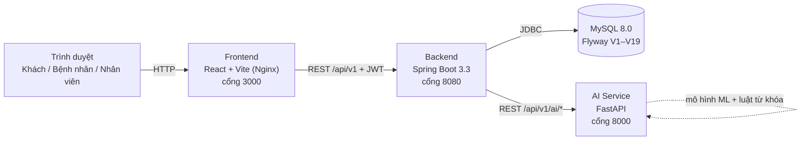

| Thành phần | Vai trò chính |
|---|---|
| **Frontend** | Một trang React, hai chế độ hiển thị: **portal** (cổng công khai) và **workspace** (không gian làm việc nhân viên). Không dùng router; chức năng mở bằng hộp thoại (modal). |
| **Backend** | Toàn bộ nghiệp vụ, xác thực JWT, phân quyền theo vai trò, truy cập cơ sở dữ liệu, gọi AI Service. Mọi phản hồi dạng `{success, data, message}`. |
| **AI Service** | Chatbot, phân loại triệu chứng vào khoa, kiểm tra tương tác thuốc/dị ứng, gợi ý chẩn đoán tham khảo. |
| **MySQL** | Lưu dữ liệu; lược đồ do Flyway quản lý, Hibernate chỉ `validate`. |

**Hai chế độ giao diện** (quyết định trong `App.jsx`):

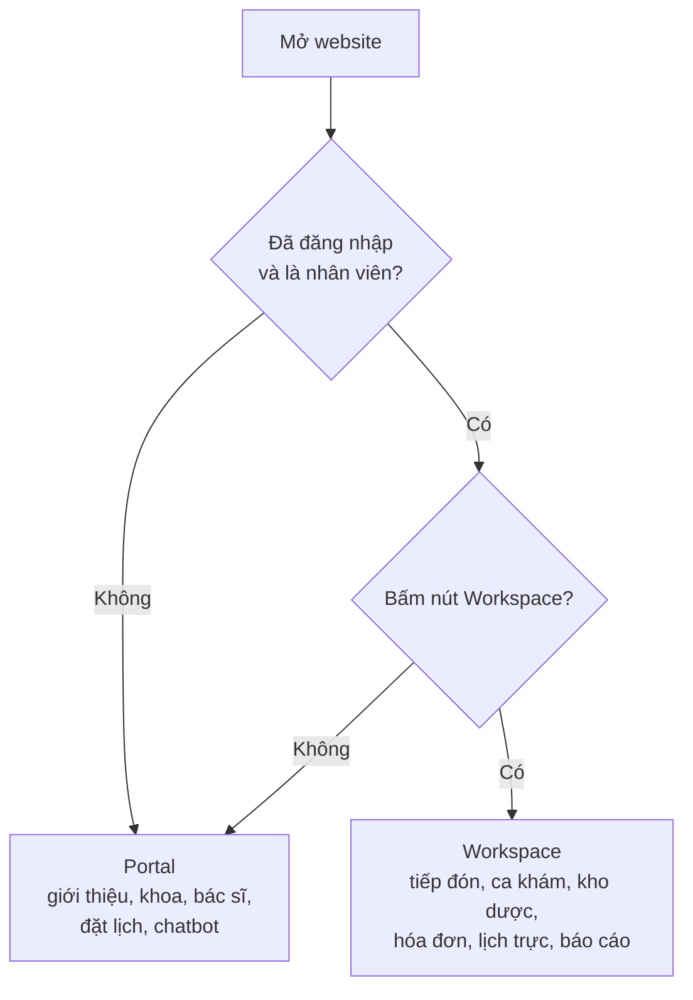

> Lịch trực **chỉ có ở Workspace**, không xuất hiện ở Portal.

---

## 2. Khởi động hệ thống

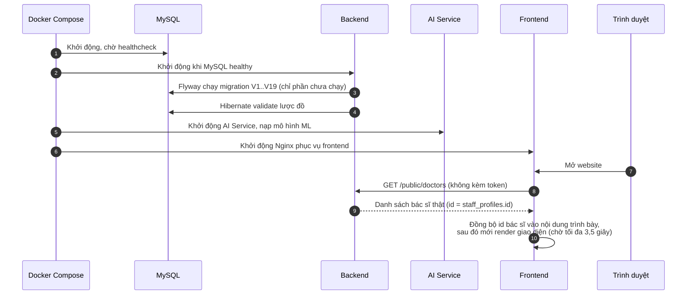

Điểm cần nhớ:

- **Nguồn dữ liệu duy nhất là cơ sở dữ liệu.** Frontend giữ nội dung trình bày (ảnh, mô tả bác sĩ), còn **mã bác sĩ thật** lấy từ API và ghép theo `username` (`bs.maianh`, `bs.nga`, ...).
- Nếu backend chưa sẵn sàng, frontend vẫn mở được nhưng **đặt lịch sẽ báo lỗi kết nối** thay vì tạo vé giả (xem [mục 16](#16-cơ-chế-dự-phòng-khi-một-thành-phần-lỗi)).

---

## 3. Hành trình của một bệnh nhân (end-to-end)

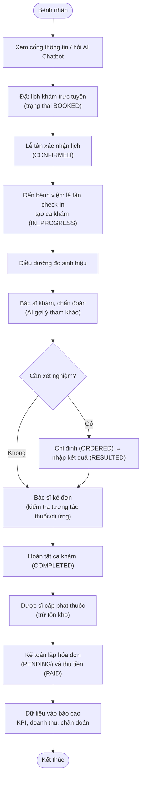

| Bước | Vai trò thực hiện | Mục |
|---|---|---|
| Đặt lịch | Khách / Bệnh nhân | [5](#5-luồng-đặt-lịch-khám-trực-tuyến) |
| Xác nhận lịch, check-in | Lễ tân | [7](#7-luồng-tiếp-đón-và-check-in) |
| Sinh hiệu, khám, kê đơn, xét nghiệm | Điều dưỡng, Bác sĩ | [8](#8-luồng-khám-bệnh-kê-đơn-xét-nghiệm) |
| Cấp phát thuốc | Dược sĩ | [9](#9-luồng-cấp-phát-thuốc) |
| Thanh toán | Kế toán | [10](#10-luồng-hóa-đơn-và-thanh-toán) |

---

## 4. Luồng xác thực và phiên đăng nhập

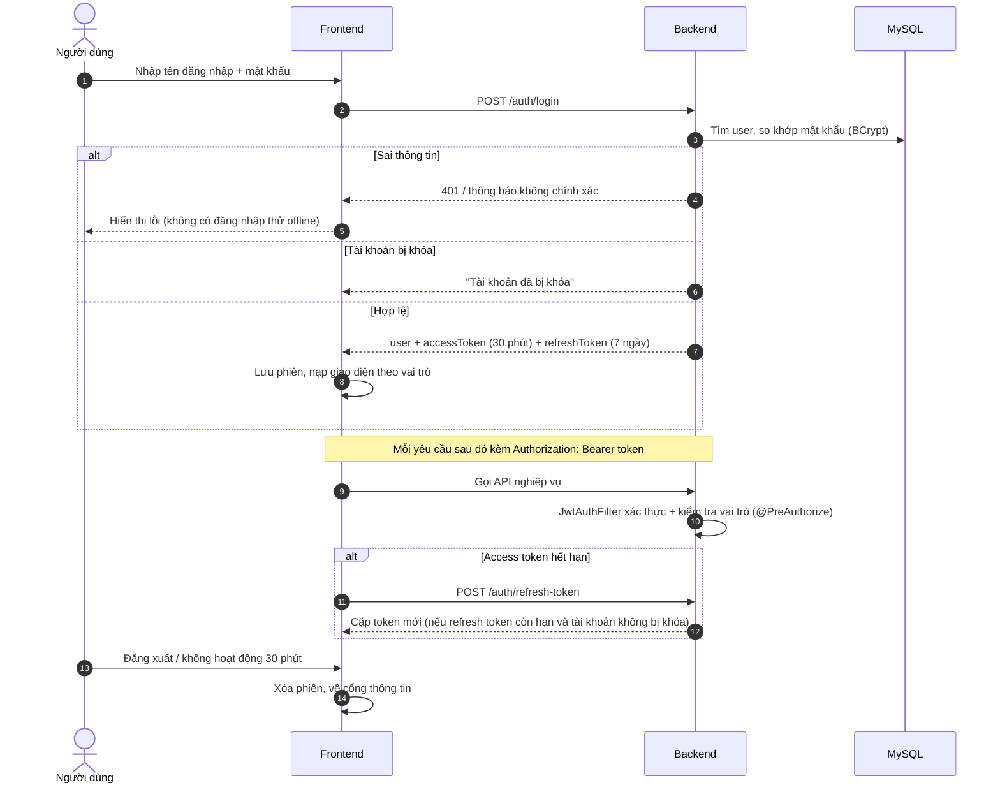

- **Đăng ký** (`POST /auth/register`): tạo tài khoản vai trò `PATIENT`, mật khẩu ≥ 8 ký tự có chữ hoa, chữ thường, chữ số; tên đăng nhập 3–50 ký tự, không trùng; email không trùng.
- Nhân viên **không tự đăng ký**; tài khoản do Quản trị viên cấp.
- Chế độ đăng nhập offline chỉ dùng được khi **máy chủ không phản hồi** và chạy ở môi trường dev; khi máy chủ trả 401 thì **không** có ngoại lệ.

---

## 5. Luồng đặt lịch khám trực tuyến

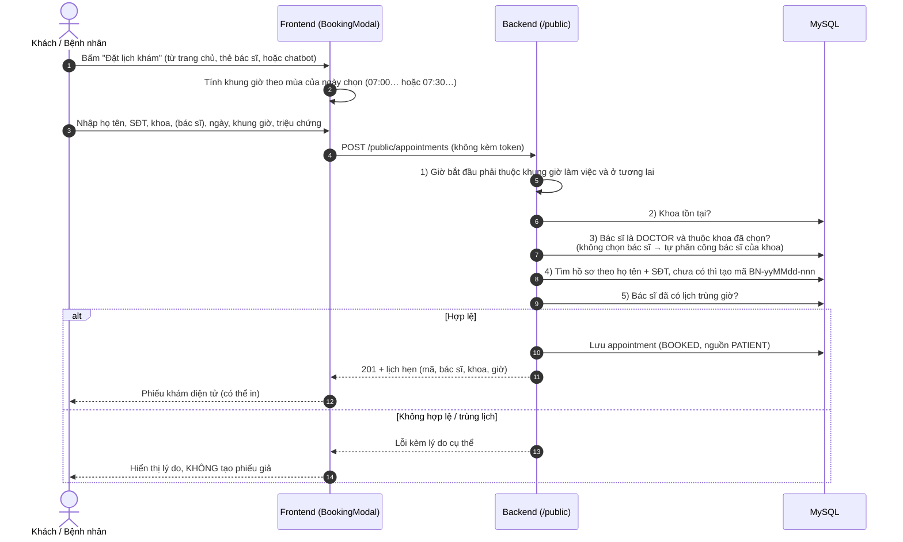

Sau khi đặt: bệnh nhân đã đăng nhập xem và hủy lịch qua `GET /appointments/me` và `PATCH /appointments/{id}/cancel`; nhân viên quản lý lịch ở [mục 7](#7-luồng-tiếp-đón-và-check-in).

---

## 6. Luồng AI Chatbot

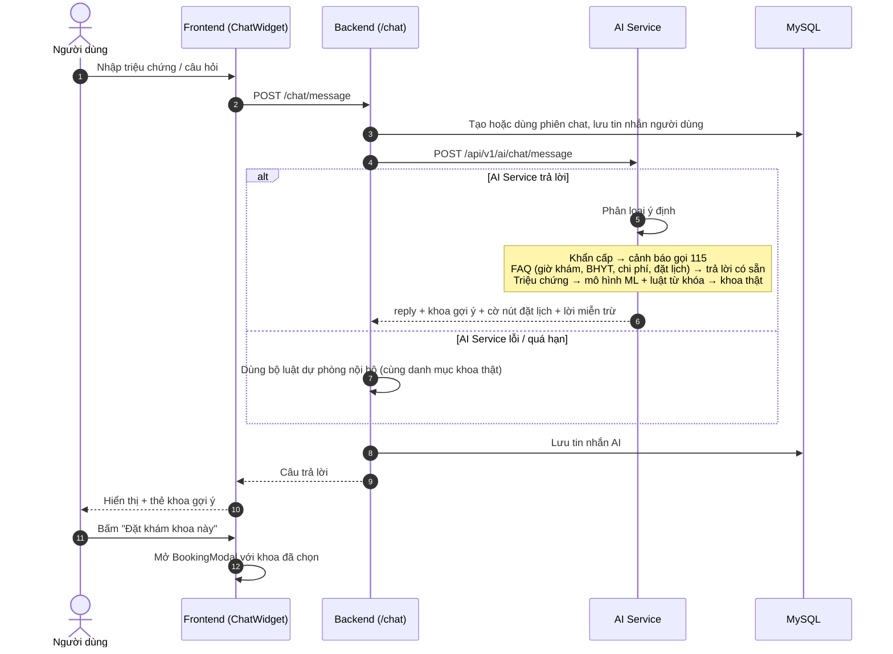

- Khoa gợi ý luôn là **khoa thật** của bệnh viện (Khám bệnh/Cấp cứu ban đầu, Ngoại khoa, Sản - Phụ khoa, Tai Mũi Họng, Y học cổ truyền – PHCN, Thẩm mỹ/Tạo hình & Da liễu). Các ca tim mạch, nhi, tiêu hóa, hô hấp, thần kinh quy về **Khoa Khám bệnh / Cấp cứu ban đầu**.
- Kết quả chatbot chỉ mang tính tham khảo, luôn kèm lời miễn trừ trách nhiệm.

---

## 7. Luồng tiếp đón và check-in

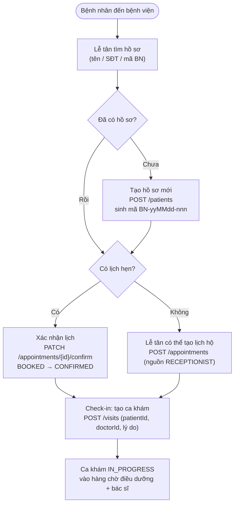

Lễ tân còn xử lý: hủy lịch, đánh dấu `NO_SHOW`, xem khung giờ trống của bác sĩ (`GET /appointments/available-slots`).

---

## 8. Luồng khám bệnh, kê đơn, xét nghiệm

```mermaid
sequenceDiagram
    autonumber
    actor N as Điều dưỡng
    actor D as Bác sĩ
    participant B as Backend
    participant A as AI Service
    participant DB as MySQL

    N->>B: PUT /visits/{id} (mạch, huyết áp, nhiệt độ, nhịp thở, SpO2, cân nặng, chiều cao)
    B->>DB: Lưu sinh hiệu (từ chối nếu ca đã COMPLETED)
    D->>B: GET /visits/{id} (xem sinh hiệu, dị ứng, lịch sử)
    D->>B: PUT /visits/{id} (lý do, mã + ghi chú chẩn đoán)
    opt Gợi ý chẩn đoán
        D->>B: POST /ai/clinical/visits/{id}/suggest-diagnosis
        B->>A: Gửi triệu chứng, sinh hiệu
        A-->>B: Chẩn đoán tham khảo
        B-->>D: Hiển thị + lưu gợi ý
    end
    opt Xét nghiệm
        D->>B: POST /visits/{id}/lab-orders (loại xét nghiệm)
        B->>DB: Lab order ORDERED
        N->>B: PUT /lab-orders/{id}/result
        B->>DB: Lưu kết quả, RESULTED
    end
    D->>B: POST /visits/{id}/prescriptions (thuốc, liều, số lượng, hướng dẫn)
    B->>A: Kiểm tra tương tác thuốc + dị ứng
    A-->>B: Mức MILD / MODERATE / SEVERE
    B-->>D: Cảnh báo; bác sĩ điều chỉnh đơn nếu cần
    B->>DB: Lưu đơn thuốc
    D->>B: PATCH /visits/{id}/complete
    B->>DB: COMPLETED (khóa chỉnh sửa)
```

- Cảnh báo AI là **tham khảo**, quyết định cuối cùng thuộc bác sĩ. Nếu AI Service không phản hồi, hệ thống dùng dữ liệu tương tác thuốc trong cơ sở dữ liệu.
- Ca khám đã `COMPLETED` **không sửa được nữa**; đây là điều kiện để lập hóa đơn và thống kê chẩn đoán.

---

## 9. Luồng cấp phát thuốc

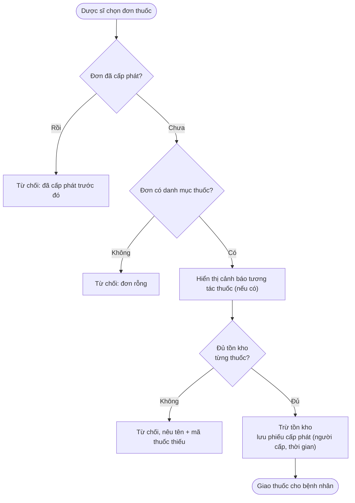

API: `POST /prescriptions/{id}/dispense`. Quản lý kho: `GET /drugs`, `POST /drugs`, `PUT /drugs/{id}/stock`, cảnh báo `GET /drugs/expiring-soon`, `GET /drugs/low-stock`.

---

## 10. Luồng hóa đơn và thanh toán

> Chi tiết thay đổi và lý do: xem [NANG_CAP_HE_THONG.md](NANG_CAP_HE_THONG.md).

```mermaid
sequenceDiagram
    autonumber
    actor KT as Kế toán / Thu ngân
    participant B as Backend
    participant DB as MySQL
    actor BN as Bệnh nhân

    KT->>B: GET /invoices/uninvoiced-visits (hàng chờ: ca khám COMPLETED chưa có hóa đơn)
    KT->>B: POST /invoices/generate/{visitId}
    B->>DB: Ca khám phải COMPLETED; đã có hóa đơn PENDING/PAID thì trả lại hóa đơn đó
    B->>DB: Tạo hóa đơn PENDING (mã HDyyMMdd######):<br/>SERVICE + DRUG (SL × đơn giá) + LAB (theo bảng giá nhóm)
    B->>B: Áp dụng BHYT → BHYT chi trả + người bệnh cùng chi trả
    B-->>KT: Hóa đơn (tổng chi phí, BHYT, số phải thu)
    KT->>BN: Báo số tiền phải trả, chọn hình thức
    alt Tiền mặt
        KT->>B: PUT /invoices/{id}/pay {CASH, amountReceived}
        B->>B: amountReceived ≥ số phải thu, máy chủ tính tiền thừa
    else VietQR / chuyển khoản / thẻ POS
        KT->>B: GET /invoices/{id}/payment-qr (số tiền + nội dung "MPH <mã HĐ>" do máy chủ sinh)
        BN-->>KT: Chuyển khoản / quẹt thẻ
        KT->>B: PUT /invoices/{id}/pay {method, transactionCode bắt buộc}
        B->>DB: Mã giao dịch không được trùng hóa đơn khác
    end
    B->>DB: PAID + thu ngân + thời điểm (khóa lạc quan chống thu trùng)
    B-->>KT: Phiếu thu (in kèm số tiền bằng chữ)
    opt Sai sót
        KT->>B: PATCH /invoices/{id}/cancel {reason} (chỉ PENDING)
        Note over KT,B: Hoàn tiền PATCH /invoices/{id}/refund {reason} – chỉ ADMIN, chỉ PAID
    end
    KT->>B: GET /invoices/summary?date= (đối soát cuối ca theo phương thức)
```

**BHYT** (thẻ do lễ tân nhập trên hồ sơ bệnh nhân, bệnh nhân không tự khai):

| Điều kiện | Kết quả |
|---|---|
| Không có thẻ / mã thẻ sai định dạng / chưa nhập hạn / thẻ hết hạn vào ngày khám | Người bệnh tự chi trả 100%, ghi lý do trên hóa đơn |
| Khám vào Chủ nhật | Không áp dụng BHYT (bệnh viện khám BHYT Thứ 2 – Thứ 7) |
| Tổng chi phí < 15% lương cơ sở (mặc định 351.000 đ) | BHYT chi trả 100% |
| Còn lại | Theo chữ số thứ 3 của mã thẻ: 1, 2, 5 → 100%; 3 → 95%; 4 → 80% |

Phí khám 150.000 đ (cấu hình `billing.consultation-fee`). Phí cận lâm sàng theo nhóm: huyết học 80.000; sinh hóa 120.000; X-quang 150.000; siêu âm 180.000; CT/MRI 500.000; loại khác 100.000 đồng. Bệnh nhân xem hóa đơn của chính mình qua `GET /invoices/me`; không xem được hóa đơn của người khác (403).

---

## 11. Luồng lịch trực nhân viên

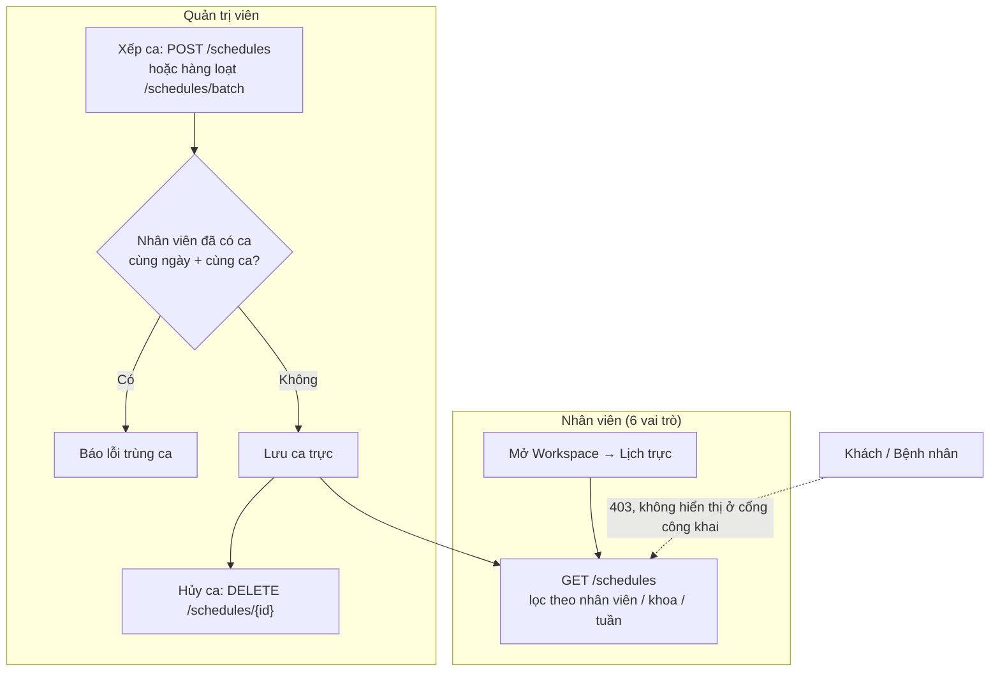

Ca trực: `MORNING`, `AFTERNOON`, `NIGHT`, `FULL_DAY`. Chỉ **Quản trị viên** xếp/hủy ca; các vai trò nhân viên còn lại chỉ xem.

---

## 12. Luồng quản trị người dùng và báo cáo

**Quản trị người dùng** (`/users`, chỉ ADMIN):

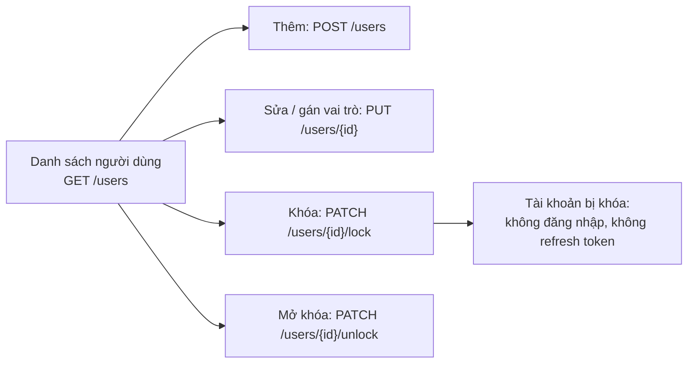

**Báo cáo** (`/reports`):

| API | Ai xem | Nội dung |
|---|---|---|
| `GET /reports/kpi-summary` | ADMIN | KPI tổng hợp |
| `GET /reports/visits-summary` | ADMIN | Tổng hợp lượt khám |
| `GET /reports/revenue` | ADMIN, ACCOUNTANT | Doanh thu theo khoảng thời gian |
| `GET /reports/top-diagnoses` | ADMIN, DOCTOR | Chẩn đoán phổ biến |

---

## 13. Máy trạng thái của các đối tượng nghiệp vụ

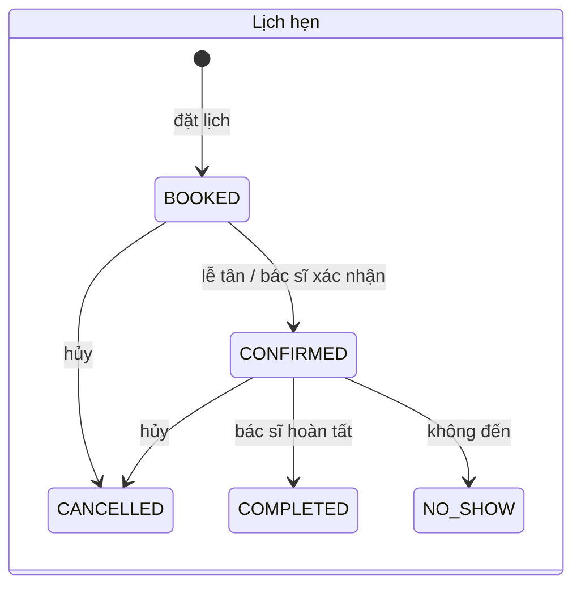

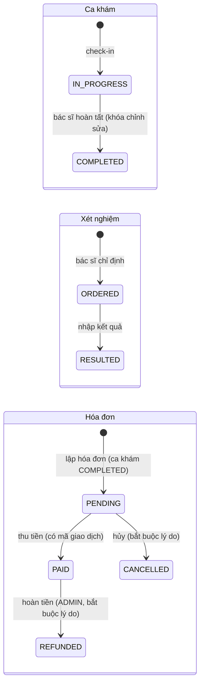

---

## 14. Quy tắc giờ làm việc

Nguồn dữ liệu duy nhất: `WorkingHours.java` (backend), `hospitalHours.js` (frontend), `hospital_catalog.py` (AI Service).

| Mục | Quy định |
|---|---|
| Khám bệnh | **Thứ 2 – Chủ nhật** |
| Mùa hè (01/04 – 31/10) | Sáng 07:00 – 11:00, chiều 13:00 – 17:30 |
| Mùa đông (01/11 – 31/03) | Lùi 30 phút: sáng 07:30 – 11:30, chiều 13:30 – 18:00 |
| Khám BHYT | Thứ 2 – Thứ 7 |
| Cấp cứu và điều trị | 24/24, kể cả ngày lễ |
| Khung khám | 30 phút; đặt lịch công khai chỉ nhận giờ bắt đầu đúng khung |

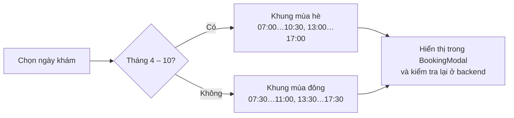

---

## 15. Phân quyền: ai làm được gì

| Chức năng | Khách | Bệnh nhân | Lễ tân | Điều dưỡng | Bác sĩ | Dược sĩ | Kế toán | Admin |
|---|:-:|:-:|:-:|:-:|:-:|:-:|:-:|:-:|
| Thông tin công khai, đặt lịch, chatbot | ✔ | ✔ | | | | | | |
| Lịch hẹn của tôi, hồ sơ cá nhân | | ✔ | | | | | | |
| Hồ sơ bệnh nhân | | | ✔ | | tra cứu | | | ✔ |
| Quản lý lịch hẹn | | | ✔ | | ✔ | | | ✔ |
| Check-in, ca khám, sinh hiệu | | | ✔ | ✔ | ✔ | | | ✔ |
| Chẩn đoán, kê đơn, chỉ định xét nghiệm | | | | | ✔ | | | ✔ |
| Nhập kết quả xét nghiệm | | | | ✔ | ✔ | | | ✔ |
| AI hỗ trợ lâm sàng | | | | | ✔ | ✔ | | ✔ |
| Cấp phát thuốc, kho dược | | | | | tra cứu | ✔ | | ✔ |
| Lập hóa đơn, thu tiền | | | | | lập HĐ | | ✔ | ✔ |
| **Lịch trực, danh bạ nhân sự** | | | ✔ | ✔ | ✔ | ✔ | ✔ | ✔ |
| Xếp / hủy lịch trực | | | | | | | | ✔ |
| Quản lý người dùng | | | | | | | | ✔ |
| Báo cáo | | | | | chẩn đoán | | doanh thu | ✔ |

Phân quyền được kiểm tra ở **hai lớp**: giao diện ẩn chức năng không thuộc vai trò, và backend chặn bằng `@PreAuthorize` (trả 403).

---

## 16. Cơ chế dự phòng khi một thành phần lỗi

| Tình huống | Hành vi của hệ thống |
|---|---|
| Backend không phản hồi lúc mở trang | Frontend vẫn hiển thị nội dung tĩnh; đặt lịch báo **lỗi kết nối**, không tạo phiếu giả |
| Backend trả lỗi nghiệp vụ khi đặt lịch (trùng lịch, giờ sai, sai khoa) | Hiển thị đúng lý do từ backend |
| Sai mật khẩu (backend trả 401) | Từ chối, không dùng tài khoản mẫu offline |
| Access token hết hạn | Tự gọi `/auth/refresh-token`; refresh hỏng thì yêu cầu đăng nhập lại |
| AI Service lỗi / quá hạn (chatbot) | Backend dùng bộ luật dự phòng nội bộ, vẫn trả lời kèm khoa gợi ý |
| AI Service lỗi (kiểm tra thuốc) | Dùng dữ liệu tương tác thuốc trong cơ sở dữ liệu |
| Mô hình ML không chắc chắn | Chuyển sang luật từ khóa; không khớp thì gợi ý Khoa Khám bệnh / Cấp cứu ban đầu |
| Từ khóa khẩn cấp | Cảnh báo gọi 115 và hotline 0789 065 493 |
| Thuốc không đủ tồn kho | Dừng cấp phát, nêu tên và mã thuốc thiếu |
| Hóa đơn đã thanh toán / đã hủy / đã hoàn tiền | Từ chối thanh toán lại |
| Mất kết nối khi thu tiền | Báo lỗi "CHƯA được lưu", không ghi nhận đã thu ở máy trạm (không còn chế độ thanh toán offline) |
| Hai thu ngân thu cùng một hóa đơn | Người thứ hai nhận lỗi 409, yêu cầu tải lại |
| Chưa cấu hình tài khoản VietQR | Ẩn mã QR, thu bằng tiền mặt / thẻ / chuyển khoản có mã giao dịch |
| Ca khám đã hoàn tất | Từ chối chỉnh sửa |

> **Lưu ý đã biết:** tài khoản bệnh nhân tự đăng ký chưa tự động có hồ sơ bệnh nhân; hồ sơ được tạo khi đặt lịch hoặc khi lễ tân tiếp đón. Vì vậy "Lịch hẹn của tôi" và "Hồ sơ của tôi" chỉ dùng được sau khi tài khoản được liên kết với hồ sơ.
