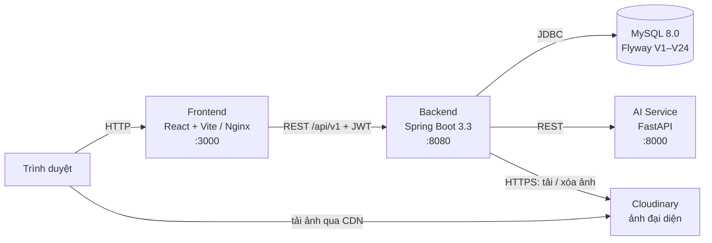

<div align="center">


# Mỹ Phát Hospital — Hệ thống Quản lý Bệnh viện tích hợp AI

Số hóa toàn bộ quy trình phòng khám: đặt lịch → tiếp đón → khám & kê đơn → cấp phát thuốc → viện phí → báo cáo, có AI hỗ trợ lâm sàng.

[](https://github.com/dinhson-11/MyPhatHospital/actions/workflows/ci.yml)
[](https://openjdk.org/)
[](https://spring.io/projects/spring-boot)
[](https://react.dev/)
[](https://fastapi.tiangolo.com/)
[](https://www.mysql.com/)
[](https://www.docker.com/)

</div>

---

## Mục lục

- [Tính năng](#tính-năng)
- [Kiến trúc](#kiến-trúc)
- [Công nghệ](#công-nghệ)
- [Bắt đầu nhanh](#bắt-đầu-nhanh)
- [Nhập thuốc từ Excel](#nhập-thuốc-từ-excel)
- [Ảnh đại diện tài khoản](#ảnh-đại-diện-tài-khoản)
- [Cấu hình (`.env`)](#cấu-hình-env)
- [Dùng cơ sở dữ liệu thật](#dùng-cơ-sở-dữ-liệu-thật)
- [Tài khoản demo & phân quyền](#tài-khoản-demo--phân-quyền)
- [API](#api)
- [Kiểm thử](#kiểm-thử)
- [Cấu trúc thư mục](#cấu-trúc-thư-mục)
- [Cơ sở dữ liệu & migration](#cơ-sở-dữ-liệu--migration)
- [Triển khai](#triển-khai)
- [Tài liệu](#tài-liệu)
- [Đóng góp](#đóng-góp)
- [Liên hệ](#liên-hệ)

---

## Tính năng

| Nhóm | Mô tả |
|------|-------|
| **Cổng bệnh nhân** | Đặt lịch khám online (chọn khoa, bác sĩ, khung giờ trống), xem lịch sử khám, đơn thuốc và hóa đơn của mình, hồ sơ dị ứng, AI chatbot tư vấn triệu chứng và gợi ý khoa khám |
| **Lễ tân - Kế toán** | Tiếp đón, tạo hồ sơ bệnh nhân, check-in; lập hóa đơn có BHYT, thu viện phí (tiền mặt, **VietQR động**, chuyển khoản, thẻ), đối soát ca, báo cáo doanh thu |
| **Bác sĩ** | Khám bệnh, kê đơn, chỉ định cận lâm sàng, **AI gợi ý chẩn đoán** và **cảnh báo tương tác thuốc / dị ứng** ngay khi kê đơn |
| **Điều dưỡng** | Đo sinh hiệu (tự tính BMI), nhập kết quả xét nghiệm |
| **Dược sĩ** | Quản lý kho thuốc, cấp phát theo đơn, theo dõi tồn kho và hạn dùng, **nhập thuốc hàng loạt từ Excel** (xem trước từng dòng, chọn nhập tiếp tồn kho cho thuốc đã có) |
| **Quản trị** | Tạo/sửa/khóa tài khoản và gán vai trò, đổi ảnh đại diện hộ, xếp lịch trực, dashboard KPI, doanh thu, top chẩn đoán |
| **Tài khoản** | **Ảnh đại diện thật** cho mọi tài khoản (lưu trên Cloudinary CDN); ảnh bác sĩ trên trang chủ chính là ảnh tài khoản của bác sĩ |
| **An toàn y khoa** | Chặn kê đơn trái dị ứng, ràng buộc ở tầng CSDL (tồn kho không âm, 1 lần cấp phát/đơn, 1 hóa đơn hiệu lực/ca khám), ẩn thông tin nhạy cảm, tự đăng xuất sau 15 phút không thao tác |

Phân quyền RBAC theo **6 vai trò**: Quản trị, Bác sĩ, Điều dưỡng, Dược sĩ, Lễ tân - Kế toán, Bệnh nhân (xem [ma trận quyền](#ma-trận-quyền-chính)).

---

## Kiến trúc



- **Backend** là điểm vào duy nhất cho dữ liệu: xác thực JWT, phân quyền, nghiệp vụ, và là gateway gọi AI Service. Các module: `auth` · `user` · `patient` · `appointment` · `clinical` · `pharmacy` · `billing` · `hr` · `reporting` · `ai` · `publicapi`.
- **AI Service** gồm chatbot (luật + NLP tiếng Việt), mô hình ML phân luồng khoa khám (scikit-learn, huấn luyện lúc build image), gợi ý chẩn đoán và kiểm tra tương tác thuốc/dị ứng. Khi mô hình ML chưa nạp, dịch vụ tự lùi về luật từ khóa.
- **Ảnh đại diện** nằm trên Cloudinary; DB chỉ lưu link ảnh và mã ảnh. Khóa Cloudinary chỉ có ở backend, trình duyệt tải ảnh thẳng từ CDN.
- **Docker Compose** chạy `backend`, `ai-service`, `frontend` và `mysql` (tùy chọn, profile `local-db`; có thể bỏ để nối vào MySQL thật).

Luồng nghiệp vụ chi tiết kèm sơ đồ trạng thái: [docs/LUONG_HOAT_DONG.md](docs/LUONG_HOAT_DONG.md).

---

## Công nghệ

| Thành phần | Công nghệ |
|------------|-----------|
| Frontend | React 19, Vite 8, Tailwind CSS 3 (build-time, chạy offline), Axios; test bằng Vitest, lint bằng oxlint |
| Backend | Java 17, Spring Boot 3.3 (Web, Security, Data JPA, Actuator), JWT (jjwt) + BCrypt, springdoc-openapi, Apache POI (đọc/tạo Excel), Cloudinary SDK |
| AI Service | Python 3.11, FastAPI, scikit-learn, pydantic |
| Cơ sở dữ liệu | MySQL 8.0, Flyway |
| Hạ tầng | Docker, Docker Compose, Nginx, GitHub Actions; Caddy (HTTPS khi deploy VM); Cloudinary (kho ảnh + CDN) |

---

## Bắt đầu nhanh

### Yêu cầu

[Docker](https://www.docker.com/products/docker-desktop/) (có Compose v2) và [Git](https://git-scm.com/).

### Chạy toàn bộ bằng Docker Compose

```bash
git clone https://github.com/dinhson-11/MyPhatHospital.git
cd MyPhatHospital

cp .env.example .env
# Sửa .env: bắt buộc đặt JWT_SECRET, nên đổi MYSQL_PASSWORD và MYSQL_ROOT_PASSWORD.
# Sinh JWT_SECRET:
#   Linux/macOS : openssl rand -base64 48
#   PowerShell  : [Convert]::ToBase64String((1..48 | ForEach-Object { Get-Random -Max 256 }))

docker compose up -d --build
docker compose ps
```

Sau khoảng 1 phút (backend khởi động và Flyway tạo schema):

| Dịch vụ | URL |
|---------|-----|
| Giao diện web | http://localhost:3000 |
| Backend API | http://localhost:8080/api/v1 |
| Swagger UI | http://localhost:8080/swagger-ui.html |
| AI Service (docs) | http://localhost:8000/docs |

Đăng nhập bằng [tài khoản demo](#tài-khoản-demo--phân-quyền). Mặc định `.env.example` bật `VITE_SHOW_DEMO_ACCOUNTS=true` nên form đăng nhập hiện sẵn các tài khoản này.

### Chạy từng dịch vụ để phát triển

<details>
<summary><b>Backend</b> (Java 17)</summary>

```bash
docker compose up -d mysql        # MySQL đóng gói, cổng máy chủ = MYSQL_HOST_PORT (mặc định 3308)

cd backend
export MYSQL_PORT=3308 MYSQL_USER=hmsai_user MYSQL_PASSWORD=<mật khẩu> JWT_SECRET=<khóa>
mvn spring-boot:run -Dspring-boot.run.profiles=dev
```

Windows PowerShell: dùng `.\mvnw.cmd` thay cho `mvn` và đặt biến bằng `$env:MYSQL_PORT="3308"`. Repo chỉ có Maven wrapper cho Windows.
</details>

<details>
<summary><b>Frontend</b> (Node 20+)</summary>

```bash
cd frontend
npm install
npm run dev        # http://localhost:3000
```
</details>

<details>
<summary><b>AI Service</b> (Python 3.11)</summary>

```bash
cd ai-service
python -m venv venv
source venv/bin/activate           # Windows: venv\Scripts\activate
pip install -r requirements.txt
python train_model.py              # huấn luyện mô hình phân luồng (~7 giây, file .joblib không được commit)
uvicorn main:app --reload --port 8000
```
</details>

> **Đã sửa code?** Container không tự cập nhật. Chạy `docker compose up -d --build backend frontend` để thấy thay đổi ở cổng 3000, hoặc chạy frontend bằng `npm run dev` khi phát triển giao diện.

---

## Nhập thuốc từ Excel

Dành cho Dược sĩ và Quản trị: **Nhà thuốc & cấp phát → tab Kho dược → Nhập từ Excel**.

1. **Tải file mẫu** (`mau-nhap-thuoc.xlsx`) và điền mỗi dòng một thuốc, tối đa 1000 dòng, file tối đa 5MB.

   | Mã thuốc* | Tên thuốc* | Đơn vị | Giá* | Số lượng* | Hạn dùng |
   |---|---|---|---|---|---|
   | tối đa 30 ký tự, tự chuyển chữ in hoa | tối đa 150 ký tự | trống = "Viên" | VNĐ, không âm | số nguyên ≥ 0 | `dd/MM/yyyy` |

2. **Chọn file → xem trước.** Bước này chưa ghi dữ liệu. Mỗi dòng có một trong ba trạng thái:
   - **Mới**: sẽ thêm vào danh mục.
   - **Đã tồn tại**: mã thuốc đã có. Tích **Nhập tiếp** để cộng số lượng vào tồn kho và cập nhật giá / hạn dùng (ô trống thì giữ giá trị cũ; tên và đơn vị giữ nguyên). Không tích thì bỏ qua.
   - **Lỗi**: ghi rõ lý do, ví dụ thiếu tên, giá âm, trùng mã trong file. Dòng lỗi không được nhập.
3. **Nhập.** Tất cả dòng được lưu trong một transaction: một dòng lỗi thì không dòng nào được lưu.

File dữ liệu mẫu để thử: [SampleDrugImport.xlsx](SampleDrugImport.xlsx) (15 thuốc mới và 3 mã đã có trong dữ liệu mẫu).

---

## Ảnh đại diện tài khoản

- **Tự đổi ảnh**: bấm tên ở góc phải → *Thông tin tài khoản* → **Tải ảnh lên** / **Gỡ ảnh**.
- **Quản trị viên đổi hộ**: *Quản trị → Tài khoản → Sửa* → khối *Ảnh đại diện* (lưu ngay khi chọn ảnh).
- Nhận ảnh JPG, PNG, WebP tối đa 5MB, kiểm tra theo nội dung file. Cloudinary cắt ảnh vuông 512px theo khuôn mặt và bỏ metadata EXIF.
- Ảnh hiện ở thanh điều hướng, khu làm việc nhân viên, danh sách tài khoản và **thẻ bác sĩ trên trang chủ**. Chưa có ảnh thì hiện chữ cái đầu tên.

**Bật tính năng:** đăng ký [Cloudinary](https://cloudinary.com) gói Free (không cần thẻ) → *Console → Settings → API Keys* → copy **API environment variable** vào `.env`:

```dotenv
CLOUDINARY_URL=cloudinary://<api_key>:<api_secret>@<cloud_name>
CLOUDINARY_FOLDER=myphat-hospital/dev/avatars   # mỗi môi trường một thư mục
```

Rồi chạy `docker compose up -d backend`. Để trống `CLOUDINARY_URL` thì hệ thống vẫn chạy, chỉ báo "Chưa cấu hình kho ảnh" khi bấm tải ảnh.

---

## Cấu hình (`.env`)

Sao chép `.env.example` → `.env`. **Không commit `.env`** (đã nằm trong `.gitignore`).

| Biến | Ý nghĩa | Mặc định / ví dụ |
|------|---------|------------------|
| `JWT_SECRET` | **Bắt buộc.** Khóa ký JWT, ≥ 48 ký tự ngẫu nhiên | — |
| `COMPOSE_PROFILES` | `local-db` = chạy MySQL đóng gói. **Xóa dòng này** khi dùng DB thật | `local-db` |
| `MYSQL_ROOT_PASSWORD`, `MYSQL_HOST_PORT` | Mật khẩu root và cổng máy chủ của MySQL đóng gói | —, `3308` |
| `MYSQL_HOST`, `MYSQL_PORT`, `MYSQL_DB` | Địa chỉ DB (mặc định trỏ vào container `mysql`) | `mysql`, `3306`, `hmsai_db` |
| `MYSQL_USER`, `MYSQL_PASSWORD` | Tài khoản ứng dụng (không dùng root) | `hmsai_user` |
| `MYSQL_SSL_MODE` | `DISABLED` / `PREFERRED` / `REQUIRED` / `VERIFY_CA` | `PREFERRED` |
| `CORS_ALLOWED_ORIGINS` | Origin của web được gọi API, phân tách bằng dấu phẩy | `http://localhost:3000,...` |
| `SWAGGER_ENABLED` | `false` = tắt Swagger UI và `/v3/api-docs` | `true` (nên tắt khi chạy thật) |
| `VITE_API_BASE_URL` | URL backend mà **trình duyệt** gọi. Nhúng lúc build frontend | `http://localhost:8080/api/v1` |
| `VITE_SHOW_DEMO_ACCOUNTS` | `true` = hiện khối tài khoản demo trên form đăng nhập. Nhúng lúc build; đặt `false` khi chạy thật | `true` |
| `VIETQR_BANK_BIN`, `VIETQR_BANK_NAME`, `VIETQR_ACCOUNT_NO`, `VIETQR_ACCOUNT_NAME` | Tài khoản nhận tiền VietQR (BIN theo NAPAS, ví dụ Vietcombank `970436`, MB `970422`; tên chủ tài khoản viết hoa không dấu). Để trống = tắt thanh toán VietQR | — |
| `VIETQR_DEMO` | `true` = hiện cảnh báo "tài khoản DEMO" (chỉ dùng với tài khoản giả) | `false` |
| `BHYT_BASE_SALARY` | Lương cơ sở (VNĐ) dùng tính ngưỡng BHYT chi trả 100% | `2340000` |
| `BILLING_CONSULTATION_FEE` | Phí khám mặc định (VNĐ) | `150000` |
| `AI_SERVICE_URL` | URL AI Service (compose tự đặt `http://ai-service:8000`) | — |
| `LLM_API_KEY` | Dành cho tích hợp LLM ngoài; **hiện AI Service chưa dùng**, có thể để trống | — |
| `CLOUDINARY_URL` | Kho ảnh đại diện, dạng `cloudinary://<key>:<secret>@<cloud>`. **Chỉ đặt cho backend.** Để trống = tắt tải ảnh | — |
| `CLOUDINARY_FOLDER` | Thư mục ảnh trên Cloudinary | `myphat-hospital/avatars` |
| `FRONTEND_PORT`, `BACKEND_PORT` | Cổng publish ra máy chủ | `3000`, `8080` |

Biến `VITE_*` được nhúng lúc build: đổi giá trị rồi chạy `docker compose up -d --build frontend`.

---

## Dùng cơ sở dữ liệu thật

Mặc định dữ liệu nằm trong volume Docker `mysql_data`. Để dùng MySQL 8 riêng (máy chủ, cloud hoặc cài sẵn trên máy):

1. **Tạo database và tài khoản** một lần bằng root của MySQL thật: sửa mật khẩu trong [scripts/db/01_create_database.sql](scripts/db/01_create_database.sql) rồi chạy
   ```bash
   mysql -u root -p < scripts/db/01_create_database.sql
   ```
   Script tạo `hmsai_db` (utf8mb4) và `hmsai_user` cho cả host `%` lẫn `localhost`. Backend trong Docker kết nối từ địa chỉ mạng Docker chứ không phải `localhost`, nên tài khoản chỉ có host `localhost` sẽ bị từ chối.
2. **Sửa `.env`**: xóa dòng `COMPOSE_PROFILES=local-db` và đặt
   ```dotenv
   MYSQL_HOST=host.docker.internal   # MySQL trên chính máy này; máy khác/cloud: tên miền hoặc IP
   MYSQL_PORT=3306
   MYSQL_DB=hmsai_db
   MYSQL_USER=hmsai_user
   MYSQL_PASSWORD=<mật khẩu ở bước 1>
   MYSQL_SSL_MODE=REQUIRED           # DB cloud / production
   ```
3. **Khởi động**: `docker compose up -d --build`. Flyway tự tạo/nâng cấp schema (V1 → V24).
4. **Khóa tài khoản mẫu**: các migration tạo sẵn tài khoản demo có mật khẩu công khai. Đăng nhập bằng tài khoản quản trị thật rồi chạy [scripts/db/02_lock_demo_accounts.sql](scripts/db/02_lock_demo_accounts.sql) để đổi mật khẩu `admin` và khóa các tài khoản còn lại.

> **Lưu ý**
> - Chỉ trỏ Flyway vào database **trống** hoặc đã do Flyway quản lý (có bảng `flyway_schema_history`). **Sao lưu** (`mysqldump`) trước mỗi lần nâng cấp.
> - **V19 xóa** tài khoản mẫu cũ `bacsi`, `duocsi` cùng lịch trực của chúng. Nếu DB thật có dữ liệu gắn với hai tài khoản này, hãy kiểm tra và sao lưu trước khi nâng cấp từ phiên bản trước V19.
> - Nếu DB đã chạy bản V20 cũ, Flyway báo `checksum mismatch` ở V20: chạy `flyway repair` (hoặc cập nhật `checksum` của version 20 trong `flyway_schema_history`) rồi khởi động lại.

---

## Tài khoản demo & phân quyền

> Chỉ dùng cho dev/demo. **Không** để các tài khoản này hoạt động trên dữ liệu thật (xem bước 4 ở mục trên).

| Username | Password | Vai trò | Chức năng chính |
|----------|----------|---------|-----------------|
| `admin` | `Admin@123` | ADMIN | Quản trị hệ thống, xếp lịch trực, báo cáo, hoàn tiền hóa đơn |
| `letan` | `Receptionist@123` | RECEPTIONIST (Lễ tân - Kế toán) | Tiếp đón, check-in, hóa đơn, thu tiền, VietQR, BHYT, đối soát ca |
| `bs.maianh` (và `bs.nga`, `bs.vy`, `bs.dung`, `bs.sy`, `bs.hiep`, `bs.an`, `bs.toan`) | `Doctor@123` | DOCTOR | Khám bệnh, kê đơn, AI chẩn đoán & cảnh báo thuốc |
| `dieuduong` | `Nurse@123` | NURSE | Sinh hiệu, BMI, nhập kết quả xét nghiệm |
| `ds.quang` | `Pharmacist@123` | PHARMACIST | Kho dược, cấp phát, cảnh báo hết hạn |
| `benhnhan` | `Password@123` | PATIENT | Đặt lịch, xem lịch sử khám và hóa đơn, AI chatbot |

Vai trò Lễ tân - Kế toán gộp hai vai trò cũ Lễ tân và Kế toán (migration V22). Tài khoản `ketoan` cũ, nếu còn trong CSDL, đã được chuyển sang vai trò này.

### Ma trận quyền chính

| Chức năng | Admin | Bác sĩ | Điều dưỡng | Dược sĩ | Lễ tân - Kế toán | Bệnh nhân |
|-----------|:-----:|:------:|:----------:|:-------:|:----------------:|:---------:|
| Tạo/sửa hồ sơ bệnh nhân | ✔ | – | – | – | ✔ | hồ sơ của mình |
| Đặt lịch, hủy lịch | ✔ | – | – | – | ✔ | lịch của mình |
| Xác nhận lịch hẹn | ✔ | ✔ | – | – | ✔ | – |
| Mở ca khám, xem danh sách ca khám | ✔ | ✔ | ✔ | – | ✔ | – |
| Khám bệnh, kê đơn, chỉ định xét nghiệm | ✔ | ✔ (ca của mình) | – | – | – | – |
| Ghi sinh hiệu, nhập kết quả xét nghiệm | ✔ | ✔ | ✔ | – | – | – |
| Cấp phát thuốc, quản lý kho | ✔ | – | – | ✔ | – | – |
| Lập hóa đơn | ✔ | ✔ | – | – | ✔ | – |
| Thu tiền, hủy hóa đơn, mã QR, đối soát ca | ✔ | – | – | – | ✔ | – |
| Xem hóa đơn | ✔ | ✔ | – | – | ✔ | hóa đơn của mình |
| Hoàn tiền hóa đơn đã thu | ✔ | – | – | – | – | – |
| Báo cáo doanh thu | ✔ | – | – | – | ✔ | – |
| KPI, lượt khám | ✔ | – | – | – | – | – |
| Top chẩn đoán | ✔ | ✔ | – | – | – | – |
| Quản lý tài khoản, xếp lịch trực | ✔ | – | – | – | – | – |
| Xem lịch trực | ✔ | ✔ | ✔ | ✔ | ✔ | – |

---

## API

Backend phục vụ REST dưới `/api/v1`, xác thực bằng JWT (access token 30 phút, refresh token 7 ngày).

| Nhóm | Prefix | Nhóm | Prefix |
|------|--------|------|--------|
| Xác thực | `/auth` | Hóa đơn, thanh toán | `/invoices` |
| Người dùng | `/users` | Đơn thuốc, cấp phát | `/prescriptions` |
| Bệnh nhân | `/patients` | Kho thuốc | `/drugs` |
| Lịch hẹn | `/appointments` | Lịch trực, nhân sự | `/schedules`, `/staff` |
| Ca khám | `/visits` | Báo cáo | `/reports` |
| Xét nghiệm | `/lab-orders` | AI lâm sàng, chatbot | `/ai/clinical`, `/chat` |
| Cổng công khai (không cần đăng nhập) | `/public` | Health check | `/actuator/health` |

Một số API đáng chú ý:

| API | Quyền | Mô tả |
|-----|-------|-------|
| `GET /drugs/import/template` | Dược sĩ, Admin | Tải file Excel mẫu |
| `POST /drugs/import/preview` (multipart `file`) | Dược sĩ, Admin | Đọc và phân loại từng dòng `NEW` / `EXISTS` / `INVALID`, không ghi dữ liệu |
| `POST /drugs/import` | Dược sĩ, Admin | Lưu các dòng đã chọn: `CREATE` (thuốc mới) hoặc `RESTOCK` (cộng tồn kho) |
| `POST` / `DELETE /users/me/avatar` | Mọi tài khoản | Đổi / gỡ ảnh đại diện của mình |
| `POST` / `DELETE /users/{id}/avatar` | Admin | Đổi / gỡ ảnh đại diện của tài khoản khác |

Tài liệu đầy đủ: Swagger UI `http://localhost:8080/swagger-ui.html` (OpenAPI JSON tại `/v3/api-docs`). Postman collection: [backend/postman/](backend/postman/).

```bash
# Lấy token
curl -X POST http://localhost:8080/api/v1/auth/login \
  -H "Content-Type: application/json" \
  -d '{"username":"admin","password":"Admin@123"}'

# Gọi API
curl http://localhost:8080/api/v1/patients -H "Authorization: Bearer <token>"
```

AI Service (backend gọi nội bộ): `POST /api/v1/ai/chat/message`, `POST /api/v1/ai/clinical/{suggest-diagnosis | check-interaction | check-allergy | check-prescription-safety}` và `GET /health`. Xem `http://localhost:8000/docs`.

---

## Kiểm thử

```bash
# Backend: JUnit 5 + Mockito; có test migration V1→V24 trên MySQL 8 thật qua Testcontainers (cần Docker)
cd backend && mvn test              # Windows: .\mvnw.cmd test

# Frontend: oxlint + Vitest + build
cd frontend && npm ci && npx oxlint && npx vitest run && npm run build

# AI Service: pytest (một số test cần mô hình đã huấn luyện)
cd ai-service && pip install -r requirements-dev.txt && python train_model.py && python -m pytest -q
```

Test không cần Cloudinary: kho ảnh được giả lập, và thiếu `CLOUDINARY_URL` thì chức năng tải ảnh tự tắt.

> Mở dự án trong VS Code (extension Java) có thể khiến IDE build đè vào `backend/target/classes` và báo lỗi giả "Flexible Constructor Bodies". Gặp lỗi `Unresolved compilation problems` khi chạy test thì dùng `mvn clean test` (Windows: `.\mvnw.cmd clean test`).

GitHub Actions ([.github/workflows/ci.yml](.github/workflows/ci.yml)) chạy đủ bốn job trên mỗi push và pull request: backend, frontend, ai-service và kiểm tra cú pháp `docker-compose.yml` ở cả hai chế độ CSDL.

---

## Cấu trúc thư mục

```
myPhatHospital/
├── backend/                  # Spring Boot REST API
│   ├── src/main/java/com/hospital/hmsai/
│   │   ├── auth/ user/ security/        # Đăng nhập JWT, tài khoản (user/avatar: ảnh đại diện), phân quyền
│   │   ├── patient/ appointment/        # Hồ sơ bệnh nhân, đặt lịch
│   │   ├── clinical/ pharmacy/          # Khám, kê đơn, xét nghiệm; kho thuốc, cấp phát, nhập Excel (pharmacy/importer)
│   │   ├── billing/ hr/ reporting/      # Viện phí (BHYT, VietQR), lịch trực, báo cáo
│   │   ├── ai/ publicapi/               # Gateway gọi AI Service; API công khai
│   │   └── config/ common/              # Cấu hình, xử lý lỗi chung
│   ├── src/main/resources/db/migration/ # Flyway V1–V24
│   └── postman/
├── ai-service/               # FastAPI: routers/, services/, models/ (schema pydantic), train_model.py
├── frontend/                 # React + Vite SPA (components/, services/, context/, tests/)
├── scripts/
│   ├── db/                   # Tạo DB thật, khóa tài khoản demo
│   └── deploy/oracle-setup.sh # Cài đặt một lệnh cho VM Ubuntu
├── docs/                     # LUONG_HOAT_DONG.md, database/, reports/ (.docx), assets/, superpowers/specs/ (thiết kế tính năng)
├── SampleDrugImport.xlsx     # Dữ liệu mẫu để thử nhập thuốc từ Excel
├── docker-compose.yml
├── .env.example
└── DEPLOYMENT.md
```

---

## Cơ sở dữ liệu & migration

Schema do **Flyway** quản lý tại `backend/src/main/resources/db/migration/`. Thư mục [docs/database/](docs/database/) chỉ là bản tham chiếu; Flyway mới là nguồn chính.

| Version | Nội dung |
|---------|----------|
| V1 – V9 | Schema: users/roles, khoa & nhân viên, bệnh nhân, lịch hẹn, ca khám & đơn thuốc, cận lâm sàng, kho thuốc, viện phí, bảng AI |
| V10 – V12 | Dữ liệu mẫu, ghi chú triệu chứng của lịch hẹn, tương tác thuốc |
| V13 – V14 | Lịch trực nhân viên, nhóm máu bệnh nhân |
| V15 – V19 | Dữ liệu tiếp đón/điều dưỡng, đồng bộ bác sĩ & lịch trực, dọn khoa/nhân viên trùng |
| V20 | Nâng cấp viện phí: BHYT, mã hóa đơn, thanh toán, hủy/hoàn tiền, 1 hóa đơn hiệu lực/ca khám |
| V21 | Ràng buộc an toàn y khoa: lý do kê đơn, 1 lần cấp phát/đơn, tồn kho không âm, 1 ca khám/lịch hẹn |
| V22 | Gộp vai trò `ACCOUNTANT` vào `RECEPTIONIST` ("Lễ tân - Kế toán") |
| V23 | Khôi phục tài khoản mẫu `bs.maianh` và `ds.quang` |
| V24 | Ảnh đại diện tài khoản: thêm `users.avatar_url`, `users.avatar_public_id` |

V20/V21 có bước dọn dữ liệu trùng trước khi thêm ràng buộc, vì vậy hãy sao lưu trước khi nâng cấp.

---

## Triển khai

Cài đặt một lệnh trên VM Ubuntu mới (Oracle Cloud Always Free hoặc VPS bất kỳ). Script cài Docker, sinh `.env` với mật khẩu ngẫu nhiên, build, chờ backend sẵn sàng, bật HTTPS (Caddy) nếu có tên miền, rồi đổi mật khẩu `admin` và khóa tài khoản demo:

```bash
curl -fsSL https://raw.githubusercontent.com/dinhson-11/MyPhatHospital/main/scripts/deploy/oracle-setup.sh -o setup.sh
bash setup.sh                       # truy cập bằng http://<IP>
bash setup.sh myphat.duckdns.org    # có tên miền: tự bật HTTPS
```

Chạy lại an toàn: giữ nguyên `.env` và mật khẩu đã sinh, chỉ cập nhật mã nguồn và build lại. [DEPLOYMENT.md](DEPLOYMENT.md) mô tả thêm phương án tách dịch vụ (Cloudflare Pages/Vercel + Render + Aiven MySQL), checklist sau deploy và các lỗi thường gặp.

**Trước khi chạy thật:** đặt `JWT_SECRET` mạnh, `VITE_SHOW_DEMO_ACCOUNTS=false`, `SWAGGER_ENABLED=false`, `MYSQL_SSL_MODE=REQUIRED` với DB cloud, `CORS_ALLOWED_ORIGINS` đúng tên miền, `CLOUDINARY_URL` (nếu dùng ảnh đại diện), và khóa tài khoản demo.

Ảnh đại diện phải nằm trên Cloudinary chứ không trên đĩa backend: Render gói Free mất mọi file mỗi lần deploy hoặc khởi động lại (xem mục 2.4 trong [DEPLOYMENT.md](DEPLOYMENT.md)).

---

## Tài liệu

| Tài liệu | Nội dung |
|----------|----------|
| [docs/LUONG_HOAT_DONG.md](docs/LUONG_HOAT_DONG.md) | Luồng hoạt động từng nghiệp vụ, máy trạng thái, cơ chế dự phòng |
| [DEPLOYMENT.md](DEPLOYMENT.md) | Hướng dẫn deploy chi tiết, cấu hình Cloudinary |
| [docs/superpowers/specs/](docs/superpowers/specs/) | Thiết kế tính năng (VD: ảnh đại diện tài khoản) |
| [docs/reports/](docs/reports/) | Bộ tài liệu đồ án (.docx): SRS, use case, thiết kế CSDL, kiến trúc & API, kế hoạch và kết quả kiểm thử, hướng dẫn sử dụng, kịch bản demo |

---

## Đóng góp

1. Tạo branch: `git checkout -b feature/ten-tinh-nang`
2. Commit theo [Conventional Commits](https://www.conventionalcommits.org/): `feat:`, `fix:`, `chore:`, `docs:`, `refactor:`, `test:`
3. Đảm bảo CI xanh (backend, frontend, ai-service, compose), rồi mở Pull Request

---

## Liên hệ

**Mỹ Phát Hospital** · 1170 Quang Trung, Thị Trấn Chũ, Lục Ngạn, Bắc Giang
Hotline: 0789 065 493 · Email: myphathospital@gmail.com · [Facebook](https://www.facebook.com/MyPhatHospital)
